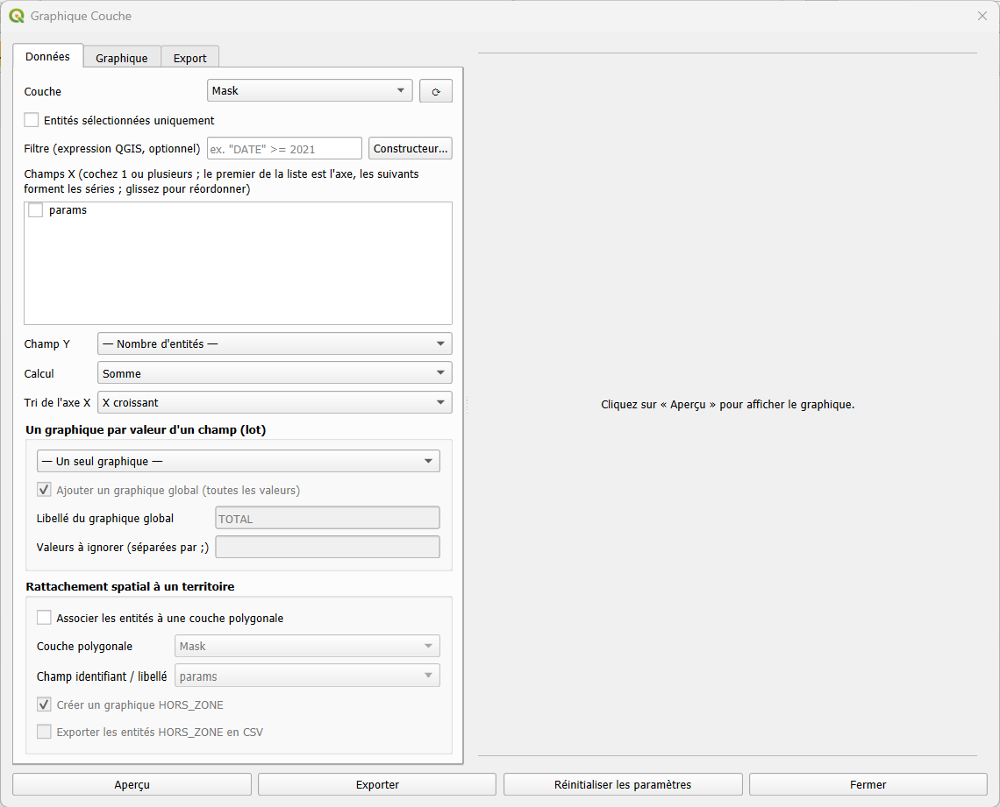
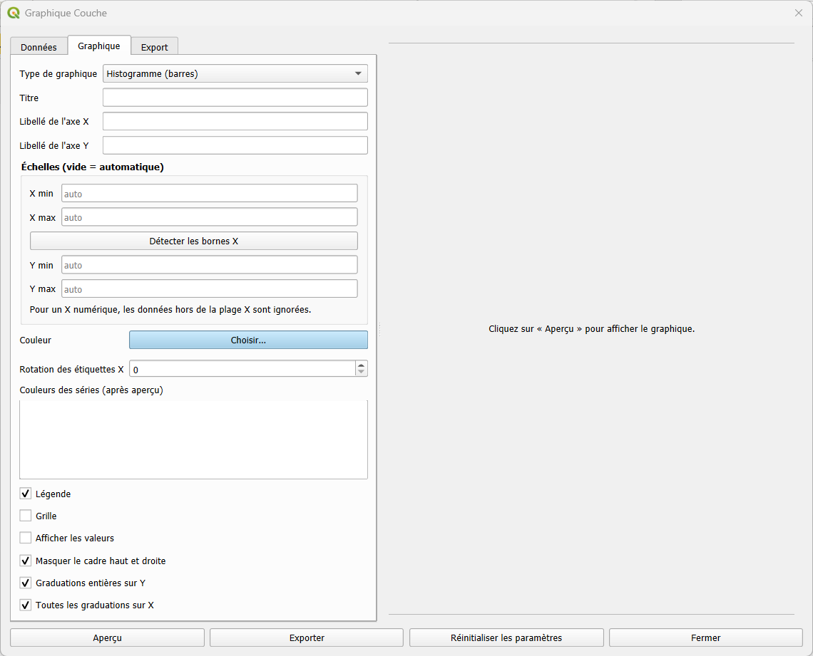
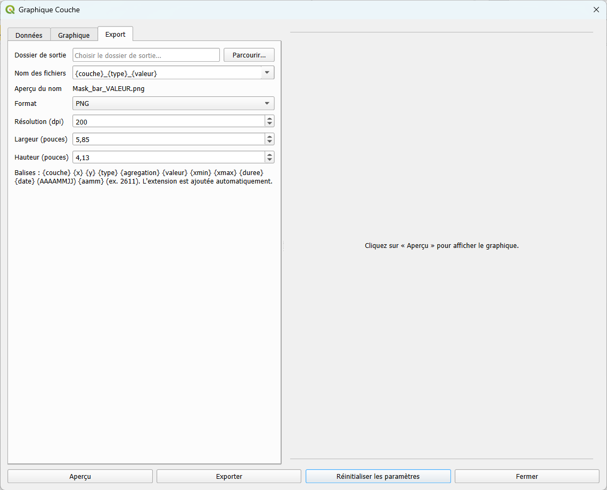
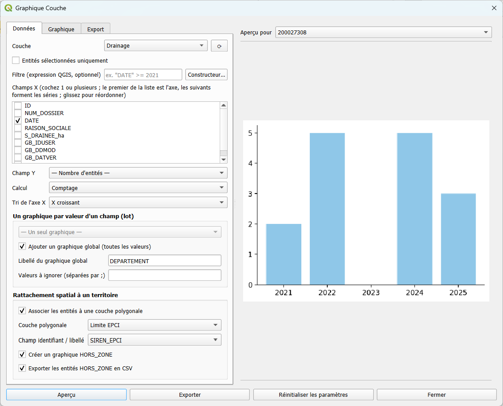

# Guide utilisateur — Graphique Couche

Ce guide accompagne le [README du projet](README.md). Il décrit un parcours complet pour créer un graphique dans QGIS, puis présente les réglages plus avancés.

## 1. Ouvrir le plugin

Dans QGIS, ouvrez **Extensions → Graphique Couche**, ou cliquez sur son icône dans la barre d'outils.

La fenêtre est organisée en trois onglets à gauche — **Données**, **Graphique** et **Export** — et une zone d'aperçu à droite. Les réglages sont mémorisés entre deux utilisations.

## 2. Préparer les données

Le plugin travaille à partir d'une couche vectorielle chargée dans le projet QGIS. Vérifiez que sa table attributaire contient les champs nécessaires au graphique.

### Choisir la couche et les entités

Dans l'onglet **Données** :

1. Choisissez la couche dans la liste. Utilisez le bouton d'actualisation si vous venez d'ajouter une couche au projet.
2. Si nécessaire, cochez **Entités sélectionnées uniquement** pour limiter le graphique à la sélection courante.
3. Vous pouvez saisir une **expression QGIS** dans le champ Filtre ou ouvrir le **Constructeur…** pour la composer. Le filtre est facultatif.



Exemple de filtre :

```qgis
"ANNEE" >= 2021 AND "ANNEE" <= 2025
```

Le filtre et la sélection sont appliqués aux entités utilisées pour le graphique. Vérifiez que l'expression est valide et que le résultat contient bien des entités.

### Définir les champs X et Y

- Cochez au moins un **champ X**.
- Le premier champ X de la liste est l'axe horizontal. Les champs X suivants deviennent des séries distinctes.
- Vous pouvez faire glisser les champs pour modifier leur ordre.
- Choisissez le **champ Y** à mesurer. Si aucun champ Y n'est choisi, le plugin compte les entités.
- Choisissez le calcul appliqué à Y : somme, moyenne, médiane, minimum, maximum, comptage ou aucun (une valeur par entité).

Le choix dépend de la question posée. Par exemple, pour représenter une surface totale par année, choisissez l'année en X, le champ de surface en Y et **Somme**. Pour compter les objets par année, laissez Y vide ou utilisez le comptage.

## 3. Régler le graphique

Dans l'onglet **Graphique**, choisissez le type adapté :

- **Histogramme (barres)** : comparer des valeurs par catégorie.
- **Barres horizontales** : comparer des catégories avec des libellés longs.
- **Barres empilées** : comparer des totaux composés de plusieurs séries.
- **Courbe** ou **Aire** : montrer une évolution.
- **Nuage de points** : comparer deux variables numériques.
- **Camembert** : représenter des parts d'un total.
- **Histogramme de distribution** : visualiser la distribution d'un champ Y en classes.



Vous pouvez ensuite régler le titre, les libellés des axes, la couleur principale, la légende, la grille, l'affichage des valeurs, la rotation des étiquettes X et les graduations.

### Bornes des axes

Les champs **X min**, **X max**, **Y min** et **Y max** sont facultatifs : laissés vides, les limites sont déterminées automatiquement.

Pour un axe X numérique, les valeurs en dehors des bornes X renseignées sont écartées du graphique. Le bouton **Détecter les bornes X** calcule les valeurs minimale et maximale à partir du champ X principal, après application du filtre et de la sélection. Les bornes restent modifiables manuellement.

La balise de nom de fichier `{duree}` utilise ces bornes X : pour des années entières de 2021 à 2025, elle renvoie 5 (bornes incluses). Le filtre seul ne définit pas cette durée.

### Couleurs des séries

Cliquez sur **Aperçu** pour générer le graphique et actualiser la liste des séries. Double-cliquez sur une série dans **Couleurs des séries** pour lui attribuer une couleur.

## 4. Produire plusieurs graphiques

### Mode lot par champ

Dans l'onglet **Données**, le groupe **Un graphique par valeur d'un champ (lot)** permet de produire un graphique pour chaque valeur distincte d'un champ, par exemple un graphique par commune ou par catégorie.

- Choisissez le champ qui définit les lots.
- Laissez cochée l'option **Ajouter un graphique global** pour produire également un graphique regroupant toutes les valeurs.
- Modifiez si besoin le libellé du graphique global (par défaut `TOTAL`).
- Indiquez les valeurs à ignorer, séparées par des points-virgules (`;`).

### Rattachement spatial à un territoire

Cette option permet de rattacher les entités de la couche source à une couche polygonale, sans ajouter ni modifier de champ dans la couche source.

1. Cochez **Associer les entités à une couche polygonale**.
2. Choisissez la couche polygonale de rattachement.
3. Choisissez le champ qui fournit le nom ou l'identifiant du territoire.
4. Activez si besoin le graphique distinct **HORS_ZONE** et/ou l'export CSV des entités sans correspondance.

Règles d'affectation :

- Une entité polygonale est affectée au territoire avec lequel elle partage la plus grande surface.
- Une entité linéaire est affectée au territoire avec lequel elle partage la plus grande longueur.
- Pour une entité ponctuelle, le plugin utilise son point représentatif.
- Si plusieurs polygones se recouvrent à égalité, le plus petit identifiant d'entité QGIS (FID) départage.
- Si les couches ont des SCR différents, le plugin tente de reprojeter la géométrie source vers le SCR de la couche polygonale.

Les entités sans correspondance ne sont pas incluses dans les totaux territoriaux. Elles peuvent être présentées dans un graphique `HORS_ZONE` et exportées dans un CSV de contrôle. Une absence de correspondance peut être normale si une entité ne croise aucun polygone ; si elle est inattendue, vérifiez les géométries, les SCR et le CSV de contrôle.

**À noter :** le mode de rattachement spatial remplace le mode lot classique dans l'interface ; les deux modes ne sont pas cumulables dans cette version.

## 5. Préparer les noms et exporter

Dans l'onglet **Export** :

1. Choisissez le dossier de sortie avec **Parcourir…** ou saisissez son chemin.
2. Saisissez un modèle de nom de fichier ou choisissez un préréglage.
3. Vérifiez l'aperçu du nom affiché sous le modèle.
4. Choisissez le format : PNG, JPEG, SVG, PDF ou TIFF.
5. Réglez la résolution en dpi ainsi que la largeur et la hauteur en pouces.



### Balises de nommage

Le modèle peut contenir les balises suivantes, remplacées automatiquement :

| Balise | Valeur |
| --- | --- |
| `{couche}` | Nom de la couche source |
| `{x}` | Champ(s) X sélectionné(s) |
| `{y}` | Champ Y, ou indication de comptage |
| `{type}` | Type de graphique |
| `{agregation}` | Calcul appliqué à Y |
| `{valeur}` | Valeur du lot ou libellé associé |
| `{xmin}`, `{xmax}` | Bornes X définies |
| `{duree}` | Nombre d'années entières entre les bornes incluses |
| `{date}` | Date du jour au format AAAAMMJJ |
| `{aamm}` | Année et mois au format AAMM |

L'extension correspondant au format choisi est ajoutée automatiquement. Les caractères dangereux pour un nom de fichier sont supprimés et les noms en doublon sont rendus uniques. Si un fichier existe déjà, le plugin demande confirmation avant de l'écraser.

Cliquez sur **Aperçu** pour afficher le graphique dans la fenêtre. L'exemple ci-dessous montre un graphique obtenu avec un champ date en X et un comptage des entités. Cliquez ensuite sur **Exporter** pour enregistrer les fichiers. En mode lot, le plugin génère les graphiques correspondant aux valeurs retenues.



## 6. Conseils et résolution des problèmes

- **Aucun graphique ou graphique vide :** vérifiez la couche, les champs X/Y, le filtre et la sélection courante.
- **Valeurs inattendues :** vérifiez le type des champs, le calcul choisi et les bornes X/Y.
- **Des entités sont HORS_ZONE :** consultez le CSV de contrôle si l'export est activé. Vérifiez les SCR et la validité des géométries des deux couches.
- **Le nom de fichier ne correspond pas à la période :** vérifiez X min et X max ; utilisez **Détecter les bornes X** si nécessaire.
- **L'export ne se fait pas :** vérifiez que le dossier existe et que vous disposez des droits d'écriture.

Pour signaler un problème, indiquez la version du plugin, la version de QGIS, le type de graphique, les réglages utiles et, si possible, un petit jeu de données reproductible. Le suivi des demandes et anomalies se fait dans le [gestionnaire de tickets GitHub](https://github.com/shenri52/qgis_plugin_graphique/issues).

## 7. Pour aller plus loin

- [README et installation](README.md)
- [Code source du plugin](https://github.com/shenri52/qgis_plugin_graphique)
- [Historique des versions](https://github.com/shenri52/qgis_plugin_graphique/releases)
